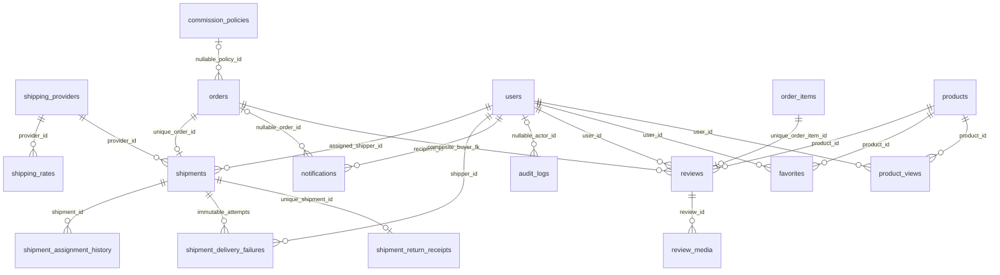

# DOC-03 — Chương Quốc Đạt (bản nháp có đối chiếu nguồn)

**Trạng thái: DRAFT / chưa nghiệm thu DOC-03.** Bản nháp phục vụ viết song song, chỉ sửa file trong `docs/report/qd-*`. Không thay đổi source, migration, API, security hoặc financial ledger. Chưa tổng hợp thành báo cáo nộp cuối vì QA-03, DOC-01 và DOC-02 còn dependency.

Mốc source dùng để mô tả: develop `fb7dcebd434c6887396881e9b34df1bf12d8250e`, ngày đối chiếu 2026-10-29 (Asia/Saigon). Master Plan gốc: `UTEExpress_Master_Project_Plan.docx`, SHA-256 `18523e581e6e2b5d2aa29d709aa4d344927e3d3a2ce21983481c4442aab68b7a`. [Task Board overlay](../MASTER_TASK_BOARD.md) chỉ là sổ trạng thái bổ sung, không thay thế Master Plan. Các tài liệu module có đoạn kết quả lịch sử được trích theo đúng source của chúng.

## 1. Phạm vi và quyền sở hữu

Quốc Đạt phụ trách Governance/Ops, cấu hình và vận hành Shipping, Notification/WebSocket, Favorite/Recently Viewed, Review, dashboard Ops và phối hợp evidence/migration. Hoàng Phúc sở hữu Security/Identity/Shop/Product; Tiến Đạt sở hữu Order/Payment/Commerce. Dù một tác vụ bắt đầu từ màn hình Ops/Shipper, thay đổi OrderStatus phải đi qua Order authority; việc ghi nhận tiền do Payment authority kiểm tra. UI không phải authority của actor, ownership, giá hay trạng thái.

| Nhóm task | Thành phần QĐ | Boundary dùng chung |
|---|---|---|
| DB-01, ADMIN-00–07 | Migration, audit, tài khoản/role, category/moderation, commission, theo dõi đơn | Account/Shop/Catalog authority của HP; lifecycle của TD |
| SHIP-00–04 | Quote/config, assignment, fulfillment, failure/retry, dashboard Shipper | Order lifecycle và COD Payment của TD |
| ENG-01, REV-01 | Favorite/recent, Review/media/public read | Catalog visibility của HP; purchased-item eligibility của TD |
| WS-01/02 | Inbox bền vững, private socket, recovery | JWT/CSRF/Account freshness của HP; history của TD |
| DASH-02 | Ops/Admin/Audit và Admin financial scope | Shared reporting projections; không tạo financial authority mới |
| QA-03, DOC-03, REL-01 | Ops evidence, chương báo cáo, chuẩn bị triển khai | HP nghiệm thu; TD review nghiệp vụ và nguồn evidence |

PROMO-03 chưa được coi đã hoàn thành: Vendor voucher/product-promotion management không đồng nghĩa Admin PLATFORM management. Cần HP/TD chốt đối tượng, quyền ADMIN/MANAGER và TD-owned management boundary. ADMIN-06 Manager limited writes hiện là **DEFERRED / ACCEPTED SCOPE EXCEPTION**, tiếp tục DENY ALL; không suy rộng ngoại lệ này sang policy khác.

## 2. Governance và audit

Các mutation quản trị lấy actor từ principal đã xác thực, kiểm tra facts phía server và CSRF; không nhận role, owner hay trạng thái tài khoản từ browser làm authority. Account/role governance sử dụng version và serialized guard để bảo vệ Admin hoạt động cuối cùng. Cấp VENDOR thuộc Shop approval, không phải một generic role form. Mutation role thành công cập nhật token/account version, làm credential/socket cũ không tiếp tục được coi hợp lệ.

`AuditLogService.append` có propagation MANDATORY: business action và audit cùng transaction, lỗi audit không bị bỏ qua. Audit ghi action/target/reason và summary allowlist; target polymorphic là logical reference, không phải FK tới mọi bảng nghiệp vụ. Không ghi mật khẩu/OTP/JWT/raw request hoặc thông tin liên hệ trong summary. Không có HTTP endpoint generic cho client tự ghi audit.

Nguồn: [audit contract](../governance-audit.md), [role governance](../ADMIN-02-role-governance.md), [AccountGovernanceService](../../src/main/java/com/uteexpress/governance/service/AccountGovernanceService.java), [RoleGovernanceService](../../src/main/java/com/uteexpress/governance/service/RoleGovernanceService.java).

## 3. Shipping và ranh giới transaction

Cấu hình provider/rate có khóa unique theo provider/service/region và guard phí hợp lệ. Checkout nhận quote server-side; snapshot Shipping của Order không được browser quyết định. Shipment giữ quan hệ duy nhất với Order, assignment chỉ chọn Shipper hiện còn đủ điều kiện. Lịch sử assignment ghi actor/cũ/mới; sau pickup không được tùy ý tái phân công.

Luồng fulfillment đồng bộ với Order/COD bằng authority phù hợp. Riêng failure/retry là Shipment-only operation: Order phải đang SHIPPING và giữ nguyên status/version/history/event. `DeliveryAttemptCoordinator` từ chối outer transaction, mở transaction Order-first rồi gọi prepare → Shipping mutation → verify; verify đọc Shipment/evidence persisted, không nhận facts caller tự dựng. Lock order của flow này là **Order → Shipment → Account**; không suy ra đây là một lock order chung cho mọi chức năng khác.

| Mutation | Shipment trước → sau | Attempt | Side effect được phép |
|---|---|---|---|
| Báo thất bại lần 1 | SHIPPING → DELIVERY_FAILED | Giữ 1 | Append evidence, tăng Shipment version đúng một lần, audit |
| Retry hợp lệ | DELIVERY_FAILED → SHIPPING | 1 → 2 | Kiểm tra evidence lần 1, version và assignment |
| Báo thất bại lần 2 | SHIPPING → DELIVERY_FAILED | Giữ 2 | Append evidence lần 2; không có retry lần 3 |

Evidence failure gắn Shipment/attempt/actor/server time, reason tối đa1000, reference tối đa255. UNIQUE `(shipment_id, attempt_number)` và `(shipment_id, source_shipment_version)` cùng trigger chống UPDATE/DELETE hỗ trợ chống ghi đè. Stale/duplicate request không tạo evidence hay side effect lần hai. Failure/retry không sửa Payment, inventory, voucher, refund hoặc buyer Return lifecycle.

Trả hàng về Shop sau giao thất bại là boundary độc lập với Buyer RECEIVE_RETURN: phải có trusted physical receipt và Ops xác nhận theo lifecycle đã tích hợp; không suy ra CANCELLED hoặc restock từ một boolean hay việc hết số lần giao. Master Plan **SHIP-04 là dashboard Shipper**; return-to-sender integration được trình bày riêng, tránh nhầm với scope proposal lịch sử.

Dashboard Shipper scope theo current assignee, mỗi Shipment đếm một lần. Success rate = `DELIVERED / (DELIVERED + RETURNED_TO_SENDER)`, làm tròn1 chữ số; không có kết quả thì hiển thị chưa có kết quả. Các trạng thái đang xử lý và CANCELLED không nằm trong mẫu số; một retry thành công vẫn chỉ là một delivered Shipment.

Nguồn: [DeliveryAttemptCoordinator](../../src/main/java/com/uteexpress/fulfillment/service/DeliveryAttemptCoordinator.java), [ShipmentAttemptService](../../src/main/java/com/uteexpress/shipping/service/ShipmentAttemptService.java), [SHIP-01](../SHIP-01-assignment.md), [SHIP-04 dashboard](../SHIP-04-dashboard.md), [Order contracts](../order-contracts.md).

## 4. Notification bền vững và WebSocket

Lifecycle hiện tại phát internal `OrderTransitionPrepared` sau khi flush history. `OrderTransitionNotificationWriter` tham gia transaction nghiệp vụ để ghi inbox; lỗi insert có thể rollback toàn bộ action. Ghi inbox cùng transaction khác với việc phát hint: `NotificationCommitPublisher` chỉ phát sau commit, không phát fake success khi rollback hoặc insert trùng.

Legacy/recovery projection vẫn tồn tại: mỗi Order được xử lý riêng, dùng committed history và dedup key history+recipient; recovery không được dùng để biện minh rằng lifecycle mới có thể commit mà thiếu inbox. Recipient lấy persisted Buyer và Shop owner tại thời điểm projection; chưa hỗ trợ Shop ownership transfer. Inbox/read luôn scope theo tài khoản xác thực, không tin userId/queue client khai.

Native WebSocket/STOMP `/ws` dùng cookie JWT hợp lệ, same-origin Origin và masked CSRF CONNECT. Không token trong URL/query; chỉ private subscription `/user/queue/notifications`, không client SEND/foreign destinations. Account ACTIVE, roles, tokenVersion và expiry được kiểm tra tại handshake/inbound/outbound; governance revocation và expiry phải chặn notification mới. Outbound authority lock-through-send dùng Account-only transaction, callback không quay vào Order/Shipment mutation; không tạo Account-first lifecycle flow.

Socket chỉ gửi hint tối thiểu; client tải lại durable inbox, có pending/trailing refresh để không bỏ hint khi fetch đang chạy. Reconnect/offline recovery dựa inbox. Đây là **single-instance simple broker, best effort hint**, không phải exactly-once delivery hay cluster fanout. Logout/pagehide/policy denial dừng socket/retry theo policy; không log token, CSRF hoặc payload riêng tư.

Nguồn: [transaction writer](../../src/main/java/com/uteexpress/notification/service/OrderTransitionNotificationWriter.java), [commit publisher](../../src/main/java/com/uteexpress/notification/service/NotificationCommitPublisher.java), [NotificationRepository](../../src/main/java/com/uteexpress/notification/repository/NotificationRepository.java), [WS-02](../WS-02-implementation-status.md), [INT-02 findings](../testing/INT-02-findings.md).

## 5. Engagement và Review/media

Favorite/recent lấy user từ principal, unique pair chống ghi trùng. Recently viewed upsert timestamp và cap30 theo tài khoản; sản phẩm không còn public/purchasable không làm rò rỉ name/price/link qua danh sách.

Review creation dùng TD-owned `OrderReviewWriteBoundary`: từ chối outer transaction, mở READ_COMMITTED, khóa **Order → Account**, recheck purchased item/DELIVERED và giữ khóa đến commit. QĐ writer MANDATORY tham gia cùng transaction, dùng `ReviewableOrderItem` server facts rồi ghi Review/media. Không tin buyer/product/order/visibility/storage key từ form. UNIQUE order_item_id cùng composite FKs buộc đúng OrderItem/Product và Order/Buyer, duplicate rollback cả transaction. Review-vs-Return được serialize: Return-first không cho tạo mới; Review-first rồi Return có thể cùng commit theo policy.

Rating1..5; comment50..2000 Unicode code points, không lấy Java UTF-16 length làm đơn vị khác PostgreSQL char_length; từ chối surrogate không hợp lệ. Tối đa3 ảnh JPEG/PNG/WebP,5MiB/ảnh,4096×4096; multipart envelope16MB không thay thế giới hạn riêng. Public read/media yêu cầu Review PUBLIC và Catalog visibility hiện tại, không trả storage key. Review đã PUBLIC tiếp tục tồn tại sau Return/Refund, nhưng không cho tạo mới khi Order đã RETURNED/REFUNDED.

DB/filesystem không phải transaction phân tán atomic. Definite rollback có compensation; UNKNOWN không xóa file có thể đã commit. Cleanup failure/deferred event phục vụ reconciliation; process crash vẫn có thể để orphan. Runbook yêu cầu dừng/drain writers, kiểm tra reference từ primary DB cả HIDDEN và không xóa file uncertain/in-flight. Có runbook/event không chứng minh logging/alert/operator production đã triển khai.

Nguồn: [ENG-01](../ENG-01-favorites-recent.md), [Review integration](../REV-01-integration-report.md), [ReviewContent](../../src/main/java/com/uteexpress/engagement/dto/ReviewContent.java), [OrderEligibilityService](../../src/main/java/com/uteexpress/order/service/OrderEligibilityService.java), [ReviewService](../../src/main/java/com/uteexpress/engagement/service/ReviewService.java), [media runbook](../REV-01-media-reconciliation-runbook.md).

## 6. Dashboard Ops/Admin và tài chính

DASH-02 giữ Ops/account/audit read model và bổ sung Admin-only financial scope. Manager không được truy cập Admin financial JSON/UI; filter Shop không thay thế authorization. Vendor lấy Shop từ principal/ownership, Admin dùng explicit all-Shops hoặc positive-Shop scope sau persisted ACTIVE ADMIN check.

Shared reporting module là authority truy vấn dùng chung, tránh governance → Order cycle hoặc sao chép SQL tài chính riêng. Wrapper đọc cùng read-only REPEATABLE_READ snapshot; đây là snapshot reporting, không phải lifecycle lock/revocation protocol. Delivered Sales theo delivered_at, Collected Payments theo paid_at, Refund/commission reversal theo kỳ refund; shipping fee không phải Vendor earnings. Net Collected = Collected − Refunds; Net Commission = accrued snapshot − reversed snapshot; Net Revenue After Commission = Net Collected − Net Commission.

Exactly one valid COD PAID evidence được chọn cùng record; failed/UNPAID attempts được giữ nhưng không làm hỏng record hợp lệ. Multiple/invalid success, missing evidence và snapshot không xác định fail-closed thành unavailable/diagnostics; không tự tính lại commission từ current policy hay clamp số âm. Aggregate theo Order/refund event grain trước Item quantities, không SUM(DISTINCT money), không double count nhiều items/attempts. EXPLAIN trong tài liệu là local synthetic baseline, không SLA production.

Nguồn: [DASH-02 financial](../DASH-02-admin-financial.md), [Ops/Audit](../DASH-02-ops-audit-report.md), [DASH-01](../DASH-01-vendor-revenue.md). Cancelled-paid refund của #70 còn là dependency chưa merge ở mốc audit; không mô tả nó như behavior đã vào develop.

## 7. ERD phạm vi QĐ

Sơ đồ là **subset quan hệ persisted**, không thay thế toàn bộ schema. Cardinality và tên được đối chiếu migration tại mốc source; users/orders/products/order_items là bảng authority liên module.

Các bảo đảm quan trọng: Shipment unique Order; route rate unique provider/service/region; evidence unique attempt/version; notification dedup key unique; Review composite FK cùng unique purchased item; media unique review/position và storage key. Receipt return-to-sender có composite Shipment/Order FK. Không thêm cascade hoặc direct SQL writer trong chương báo cáo. Danh sách file nguồn và SHA-256 được lưu ở [source index](qd-source-index.json).

## 8. Evidence và giới hạn nghiệm thu

| Source / phạm vi | Evidence thực sự | Không suy rộng |
|---|---|---|
| QA01 tested6e93d44, reviewed026a29d, merged#66 | HP694unit+1346PG=2040; QĐ33Node+17tooling độc lập và scoped delta review | Không coi QĐ đã chạy mới2040; SCA execution NOT RUN, HP đã deferred scope rõ trong Task Board |
| #68 tested8705e8a, packetccf9f32 | QĐ705unit+1352PG=2057;33Node+17tooling PASS;141XML/log hashes checked | Source của nhánh PR, không phải developfb7; không phải evidence #70/combined seed |
| Combined sourcef9c6fd6, packet#69 | QĐ2078Java/PG+33Node+23tooling; normal/-2s and TD independent-process rerun/fingerprint34tables PASS | Không relabel thành postmerge develop/latest#68 evidence; synthetic bootstrap/checkpoint scope chờ HP |
| Q70-S01 | HP ACCEPTED RISK — LIMITED với bất định của historical fixture CONFLICT | Không RESOLVED; giữ FAIL và production chronology guards; mở lại khi trigger |
| QA03 G01/UI02 | Matrix375/768/1440 có sẵn; công cụ khởi tạo lỗi, chưa có actual Ops screenshots | **NOT RUN/BLOCKED**, không suy từ unit/HTTP hoặc screenshot Buyer cancellation phạm vi hẹp |
| REL01/T49 | Checklist có thể chuẩn bị; cấu hình prod/ENV đã có | Clean-host, upload persistence, off-host DB+uploads restore, live TLS/SMTP/logging chưa có acceptance target-host |

Evidence links: [QA01 manifest](../testing/QA-01-evidence-manifest.md), [QD #68 review](https://github.com/hphuc032/Logistic-UTEExpress/pull/68#pullrequestreview-5693111426), [independent #68 packet](https://github.com/hphuc032/Logistic-UTEExpress/tree/ccf9f32/docs/testing/qa68-qd-postsync-8705), [combined source packet](https://github.com/hphuc032/Logistic-UTEExpress/tree/5ff8113/docs/testing/qa03-hp-integration-validation), [HP limited-risk decision](https://github.com/hphuc032/Logistic-UTEExpress/pull/69#issuecomment-6486630710).

## 9. Việc còn thiếu và cách làm song song

| Việc | QĐ làm ngay | Chờ ai / điều kiện |
|---|---|---|
| DOC03 | Viết chương QĐ, ERD subset, source/evidence index trên file docs riêng | TD review correctness; HP DOC01 + TD DOC02 + QA03 trước bản tổng hợp cuối |
| QA03 G01 | Chuẩn bị matrix/role/source capture, phối hợp chạy manual | Công cụ Computer Use hoặc HP/UI hỗ trợ; actual375/768/1440 evidence |
| #68 | Independent delta/full-PG đã thực hiện trên8705 | TD sync latest docs, xác minh executable equality/CI; HP quyết định merge |
| #70 | Chuẩn bị migration/old-ledger review checklist | #68 thực sự merge; TD business invariants; HP quyết định |
| #69/G02 | Giữ packet/history và source guards | #68+#70 merge, sync và fresh full/normal/-2s/rerun; HP bootstrap/checkpoint acceptance |
| PROMO03 | Boundary proposal/design test cases; không tự tạo promotion authority | HP scope/Manager policy, TD management service contract |
| REL01 | Draft operator checklist/private ENV placeholders và evidence requirements | QA gates/target host/operator/HP review trước nghiệm thu deployment |
| REV02 | Chưa mở feature P3 | QA03 và mandatory stable acceptance; chỉ khi còn thời gian |

Phân vùng file để tránh va chạm: QĐ draft chỉ `docs/report/qd-*`; TD tiếp tục Order/Payment/QA02 trên branch riêng; HP xử lý Security/UI/final review. Không sửa Master Plan gốc, không cập nhật trạng thái QA của người khác, không tự merge develop/main/tag. Khi thiếu nguồn DOC01/DOC02 hoặc ảnh manual, giữ placeholder **CHỜ BÀN GIAO**, không viết evidence giả.

## 10. Checklist chuyển từ draft sang báo cáo cuối

- [ ] TD review thuật ngữ Order/Payment, lock/transaction boundary và attribution tài chính.
- [ ] HP đối chiếu security scope/exception, privacy, sơ đồ và phần UI/manual.
- [ ] QA03 G01/G02 có actual accepted evidence; cập nhật exact source sau integration.
- [ ] Nhận DOC01/DOC02; thống nhất danh mục hình/bảng/thuật ngữ và trích dẫn.
- [ ] Render/kiểm tra hình ERD và ảnh thật khi xuất Word/PDF; draft Markdown chưa phải bản đã render.
- [ ] REL01/REL02 báo cáo riêng PASS/FAIL/NOT RUN, không dùng trạng thái draft làm acceptance.

Bản nháp không tự thỏa dependency DOC03 hoặc điều kiện release. Tiêu chí của chương là mô tả đúng implementation và giới hạn hiện tại để nhóm có thể review song song.
